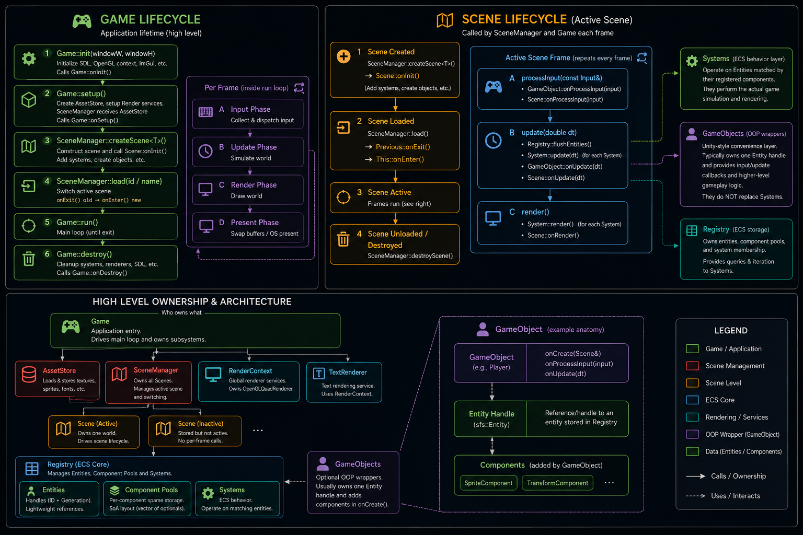

# Game lifecycle

A SFS game has three nested layers, each a class you subclass and whose hooks the
engine calls for you:

```
Game     your application — window, the main loop, which scenes exist
  └─ Scene     a level or screen — owns the entities, systems, and game objects
       └─ System / GameObject     your gameplay and rendering logic
```

You never write the loop yourself; you override hooks and the engine drives them.



## Game — the application

Subclass `Game` and override the hooks you need. The engine runs `init()` →
`setup()` → `run()` (the loop) → teardown; your overrides hang off those:

| Hook | When | Typical use |
| --- | --- | --- |
| `onSetup()` | once, at startup | create your scenes; stand up Lua |
| `onInit()` | once, after init | app-wide setup |
| `onProcessInput(input)` | each frame | app-level input |
| `onUpdate(dt)` | each frame | app-level update |
| `onRender()` | each frame | app-level draw (HUD, overlays) |
| `onDebugUI()` | each frame (debug builds) | an ImGui debug panel |
| `onDestroy()` | at shutdown | teardown (the one required override) |
| `makeRenderBackend()` | once | return the render backend; defaults to the first one offered |

```cpp
class MyGame : public sfs::Game
{
protected:
  void onSetup() override
  {
    // createScene<T>() builds the scene, makes it current, and runs its onInit.
    sceneManager.createScene<MyScene>("Game");
  }

  void onDestroy() override { /* teardown */ }
};
```

The default `makeRenderBackend()` returns the first backend registered in
`RenderBackends` (call `registerWebGpuBackend()` before `init()` to offer the
engine's), or override it to return one directly, such as a
`WebGpuRenderBackend`. The same backend and renderer draw every style of game;
see [Render backends](../rendering/backends/index.md).

`renderBackend()` returns a non-owning pointer to the active backend; cast it to
the concrete type when a scene needs the device directly.

### Controlling the game from game code

Scenes know their game (`scene.game()`), so scripts can control it:

| Call | Does |
| --- | --- |
| `quit()` | Ends the game after this frame's updates, through the `onQuit()` hook (by default, the loop stops) |
| `loadScene(path)` | Switches to a scene file after this frame's updates, through `onLoadScene(path)`, which by default calls `playScene(path)` |
| `setWindowTitle`, `setFullscreen`, `isFullscreen`, `setWindowSize`, `windowSize` | The window. Ignored when `ownsWindow()` is false (the editor), and logged once. |

Both requests run after every script has updated, so a script can call them
without being destroyed partway through its own update.

`playScene(path)` is the one way a scene file gets played: `replaceScene()`
destroys the current scene and creates a fresh `StandardScene`, then
`StandardScene::play(file)` loads the file and starts its scripts and game systems.
Paths are relative to `gameFolder()`. The exported-game player starts its
first scene this way, and the editor does the same during Play. Hosts change
only the pieces that differ:

| Hook | Default | Player | Editor |
| --- | --- | --- | --- |
| `gameFolder()` | The working directory | The export folder | The project folder |
| `replaceScene()` | A plain `StandardScene` | (default) | Its own scene type, seen through the scene's camera |
| `onLoadScene(path)` | `playScene`, logging a failure | Shows an error and exits on failure | Stops Play on failure, and only switches while playing |

A host that draws the scene into part of its window overrides `sceneView()` to
say where: the window (by SDL window id) and a rectangle in it. Mouse positions
reach the scene relative to that rectangle, and only from that window. By
default the view is the whole window. Such a host also overrides
`sceneReceivesMouse()` to say whether mouse presses and the wheel should reach
the scene right now (always, by default): the editor passes them on only while
the pointer is over the game's view, so scrolling another panel doesn't zoom
the game's camera. Mouse releases always get through, so a drag that ends
outside the view doesn't leave a button stuck down.

## Scene — a level or screen

A `Scene` owns one world: its entities, systems, and game objects. Subclass it and
build the level in `onInit()`:

| Hook | When |
| --- | --- |
| `onInit()` | once, when the scene is created |
| `onEnter()` / `onExit()` | when it becomes / stops being the current scene |
| `onProcessInput(input)` | each frame |
| `onUpdate(dt)` | each frame |
| `onRender()` | each frame |
| `onDebugUI()` | each frame (debug builds) |

```cpp
class MyScene : public sfs::Scene
{
  using sfs::Scene::Scene; // inherit the (id, services[, name]) constructors

protected:
  void onInit() override
  {
    addSystem<MovementSystem>();                       // register systems
    auto& render = addSystem<sfs::RenderSystem>(renderer());
    render.withModule<sfs::SpriteModule>(assetStore()); // what it draws

    sfs::Entity e = createEntity();                    // spawn entities
    e.addComponent<sfs::TransformComponent>();

    createObject<Player>();                             // or a GameObject actor
  }

  void onUpdate(double dt) override { /* scene-wide per-frame logic */ }
};
```

Inside a scene you have `createEntity()`, `createObject<T>()`, `addSystem<T>()` /
`getSystem<T>()` / `tryGetSystem<T>()` / `hasSystem<T>()`, plus the engine
services: `assetStore()` and `renderer()`, the backend's renderer. Without a
renderer (a headless host) `renderer()` logs and aborts; `tryRenderer()`
returns null instead. See [Rendering](../rendering/index.md#scene-services).
Without a `Space2D` the render system draws a 3D world; see
[Styles](../rendering/styles/index.md) for a flat or isometric game.

Manage scenes through the scene manager: `sceneManager.createScene<T>(name)` builds
one (and makes it current), `sceneManager.load(name)` switches to an existing one,
and `sceneManager.current()` returns the active scene.

## The frame loop

Each tick the engine runs three phases and fans each out through the current scene
to its systems and game objects:

```
processInput → update(dt) → render
```

- **processInput** — `Game::onProcessInput`, then the scene's, then each
  GameObject's `onProcessInput`.
- **update** — `Game::onUpdate`, the scene's `onUpdate`, every enabled `System`'s
  `update(dt)`, and each GameObject's `onUpdate`.
- **render** — every `System`'s `render()` (this is where `RenderSystem` draws),
  then `onRender`.

## Putting it together

```cpp
// main.cpp
int main()
{
  MyGame game;
  if (!game.init(1280, 720))   // window, GPU device, engine services
    return 1;
  game.setup();                // runs your onSetup -> create scenes
  game.run();                  // the main loop until quit; tears down on exit
  return 0;
}
```

That's the whole shape: `Game` owns the loop and your scenes; a `Scene` owns the
entities, systems, and objects; systems and game objects carry the behaviour.
